### Hi, I'm Usama 👋

I'm a **UI/UX & Product Designer** with 4+ years of experience designing digital products across **fintech, investing and health tech**. I care about clear flows, sharp visual systems and motion that makes an interface feel alive. Lately I've been taking my designs further by building them myself in code.

- 🎨 Designing product experiences, from research and flows to high-fidelity UI and design systems
- 🧪 Exploring creative front-end: scroll storytelling, canvas effects and GSAP motion
- 📍 Based in Karachi, Pakistan, and working with teams worldwide
- 💬 Open to freelance projects and full-time product design roles

---

### ✨ Featured work

<table>
  <tr>
    <td width="50%" valign="top">
      
      <h4><a href="https://github.com/tanoliusama249-star/gta6-fan-site">GTA VI — Fan Site</a></h4>
      Cinematic scroll-driven landing page: pinned scenes, a trailer with a custom cursor, and a 3D map card that morphs into a product card. 
      <b>HTML · CSS · JavaScript · GSAP · ScrollTrigger · Lenis</b>
    </td>
    <td width="50%" valign="top">
      
      <h4><a href="https://github.com/tanoliusama249-star/vi-vice-city-site">VI — Vice City Concept</a></h4>
      Editorial concept site: a self-assembling collage, a fly-through of giant letters, a tilted 3D gallery wall and a horizontal character carousel. 
      <b>HTML · CSS · JavaScript · GSAP · ScrollTrigger</b>
    </td>
  </tr>
  <tr>
    <td width="50%" valign="top">
      
      <h4><a href="https://github.com/tanoliusama249-star/particle-portrait-hero">Particle Portrait Hero</a></h4>
      Interactive portfolio hero: a portrait made of thousands of particles that scatter around the cursor, with a live HUD overlay. 
      <b>HTML · Canvas 2D · JavaScript, with no libraries</b>
    </td>
    <td width="50%" valign="top">
      <h4>🌐 More of my design work</h4>
      Case studies, product UI and branding live on my portfolio:  
      <a href="https://www.usama.design"><b>www.usama.design →</b></a>
    </td>
  </tr>
</table>

---

### 🧰 Toolbox

**Design** 

**Build** 

---

### 📫 Let's work together

Fan projects on this profile are unofficial and made for learning. All game artwork belongs to its respective owners.
